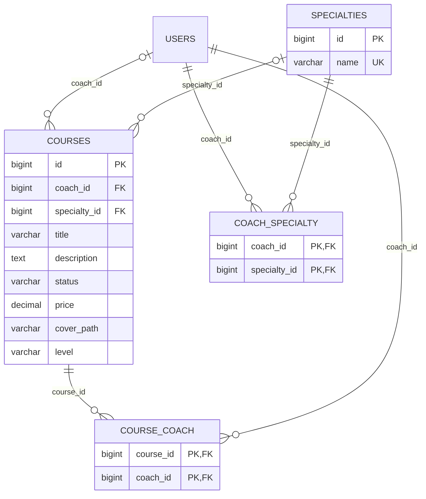

# Datos iniciales de cursos y especialidades

El modelo organiza los cursos por especialidad y relaciona cada Coach con las materias que puede impartir. El esquema se reproduce mediante migraciones. La API permite crear cursos como borrador o publicado y consultar un catálogo público; React ofrece el formulario de creación y el catálogo de tarjetas en `/courses`.

## Tablas y decisiones

`specialties`: `id`, `name` (texto de hasta 100 caracteres, único), `created_at` y `updated_at`. Una especialidad puede agrupar varios cursos; cada curso tiene como máximo una especialidad. Se renombra la tabla anterior `categories` conservando filas e identificadores. No hay una categoría general adicional.

`coach_specialty`: `coach_id` a `users.id` y `specialty_id` a `specialties.id`, con clave primaria compuesta para impedir asociaciones repetidas e índice por especialidad para buscar sus Coaches. Un Coach puede tener varias especialidades y cada especialidad varios Coaches. Al eliminar un usuario o especialidad sin cursos que lo impidan se eliminan sus asociaciones, sin borrar el otro extremo. No se añadieron datos de ejemplo ni se asignaron especialidades a las cuentas existentes.

`course_coach`: relación N:M de los Coaches adicionales de un curso. Contiene `course_id` a `courses.id` y `coach_id` a `users.id`, con clave primaria compuesta e índice por Coach. El responsable permanece únicamente en `courses.coach_id`; la API rechaza incluirlo también como adicional. Cada colaborador debe tener rol Coach y estar asignado a la especialidad del curso. Si se elimina un curso, se eliminan sus asociaciones; eliminar una cuenta colaboradora referenciada queda restringido. No se alteran las asignaciones existentes de responsables ni se inventan colaboradores para cursos anteriores.

`courses` conserva sus campos originales y añade:

| Campo | Tipo y valor inicial | Responsabilidad |
| --- | --- | --- |
| `id` | Clave primaria existente | Número estable compartido por catálogo y gestión; no se renumera tras borrar |
| `coach_id` | FK nullable a `users.id` | Coach responsable; no es necesariamente quien pulsa crear |
| `specialty_id` | FK nullable a `specialties.id` | Asignatura o videojuego del curso; sustituye `category_id` |
| `status` | `draft` por defecto; admite `draft` o `published` | Separar preparación y publicación |
| `price` | `DECIMAL(10,2)`, obligatorio, 0 por defecto; CHECK >= 0 | Importe en euros; cero significa gratuito |
| `cover_path` | Texto nullable, hasta 255 caracteres | Ruta interna de la portada en el disco privado local; no se expone en la API |
| `level` | Enum nullable: beginner, advanced, expert | Nivel del curso; null significa sin clasificar y conserva así los cursos anteriores |

Las FK admiten nulos para conservar cursos anteriores sin inventar responsables ni especialidades. POST `/api/v1/courses` permite crear a Coach y Administrator, con un responsable elegido de rol Coach y perteneciente a la especialidad. El creador Coach debe pertenecer también a esa especialidad; Administrator no necesita pertenecer a ella. Las FK por sí solas solo acreditan existencia. El responsable es único y puede haber varios Coaches adicionales de la misma especialidad. El estado inicial y su modificación posterior mediante PATCH admiten draft/published según los permisos de edición descritos más abajo.

Las eliminaciones de usuarios/especialidades referenciados por cursos se restringen: borrar una cuenta o especialidad no elimina cursos ni rompe referencias. No se añaden borrado lógico, pagos ni inscripciones. EUR es la moneda funcional acordada para esta primera versión; no hay conversión ni cobros. No se duplica el precio con un booleano `is_free`.

Relaciones Eloquent utilizadas en pruebas: `User::specialties()`, `Specialty::coaches()` y `Course::additionalCoaches()` con belongsToMany; `Specialty::courses()` con hasMany; `Course::specialty()` y `Course::coach()` con belongsTo. `Specialty::coaches()` filtra por rol Coach, incluso si una asociación errónea de un Student se insertara directamente en la base. El filtro de lectura no sustituye la autorización de escritura del servidor. El precio del modelo Course se convierte a decimal de dos posiciones.



## Migraciones y comprobaciones

### Creación de cursos

El nivel se guarda mediante `CourseLevel`: beginner (principiante), advanced (avanzado) o expert (experto). POST acepta `level` opcional por compatibilidad con el formulario anterior; cuando se incluye se valida como uno de esos tres valores. Omitirlo guarda null, sin elegir un nivel por defecto. Las respuestas de creación y catálogo incluyen level como cadena o null. La migración conserva los cursos existentes sin clasificarlos automáticamente; sus docentes autorizados o Administrator pueden asignarlo posteriormente con PATCH courses/{course}.

POST `/api/v1/courses` requiere sesión Coach o Administrator y CSRF. Recibe `title` (obligatorio, hasta 255 caracteres), `description` (obligatoria, hasta 10000), `specialty_id` y `price` (0 a 99999999.99 EUR, máximo dos decimales con punto). `coach_id` permite elegir al responsable y es obligatorio para Administrator; para Coach es opcional y, si se omite, se utiliza el usuario de sesión por compatibilidad con la primera versión. El responsable elegido debe ser Coach de la especialidad. `additional_coach_ids` es opcional, con hasta 100 identificadores distintos de otros Coaches de la especialidad, sin repetir al responsable. El creador puede incluirse como colaborador si elige a otra persona como responsable. `status` es opcional, admite únicamente draft/published y conserva draft si se omite. Student recibe 403. Se elige al crear; no se publican automáticamente los borradores existentes.

La creación admite JSON sin portada y `multipart/form-data` con un archivo opcional `cover`. Devuelve 201 con `data`: id, título, descripción, responsable, especialidad, estado, nivel, precio como cadena con dos decimales, `additional_coaches` (id/nombre) ordenados por nombre/id y `cover_url` (URL relativa protegida o null). Location señala ahora la URI privada GET courses/{course}; no amplía los permisos de acceso. El contrato está en [OpenAPI](../backend/openapi.json).

GET/HEAD `/api/v1/specialties` permite ahora al Coach consultar únicamente sus especialidades asignadas, con la paginación existente. Administrator conserva el catálogo completo y la creación de especialidades; Student sigue sin acceso. Un Coach sin asignaciones recibe una lista vacía y no puede crear un curso hasta que se le asigne una especialidad.

GET/HEAD `/api/v1/specialties/{specialty}/coaches` permite consultar candidatos tras elegir especialidad. El Coach solo consulta grupos a los que pertenece; ahora la lista incluye a todos sus Coaches, también al usuario de sesión si está asignado, para permitir elegir responsable. Administrator consulta cualquier especialidad; Student no tiene acceso. Devuelve únicamente id/nombre con paginación y orden nombre/id, sin correos ni otros datos privados. Una especialidad inexistente devuelve 404 y una ajena al Coach devuelve 403. El frontend debe excluir al responsable elegido de la selección de colaboradores.

La transacción de creación bloquea las filas del creador, el responsable y los colaboradores por id ascendente, igual que la edición administrativa, y vuelve a comprobar roles y pertenencia. Así, las operaciones HTTP no pueden quitar una asignación o cambiar el rol entre la comprobación y el guardado del curso. La edición administrativa tampoco puede retirar roles/especialidades que usan los cursos como responsable o colaborador.

### Consulta y edición privadas

GET/HEAD `/api/v1/teaching/courses` lista los cursos del Coach como responsable o colaborador; Administrator consulta todos, incluidos borradores. GET/HEAD `/api/v1/courses/{course}` devuelve un curso editable. ManagedCourseResource añade responsable/especialidad con id/nombre (null si faltan en una fila heredada) y las capacidades can_change_responsible/can_delete. No expone correos ni rutas de disco. Las respuestas son privadas y no almacenables; Student, visitantes y Coaches no participantes no obtienen estos datos.

PATCH `/api/v1/courses/{course}` requiere sesión y CSRF. Responsable, colaboradores y cualquier Administrator pueden cambiar título, descripción, nivel, precio, estado, especialidad, colaboradores y portada. La identidad protegida es el responsable actual; no se conserva otra cuenta de creador histórico. Un colaborador no puede sustituir al responsable; solo el responsable actual o Administrator pueden hacerlo. El responsable permanece separado de additional_coach_ids y vaciar esa lista no lo elimina. Un colaborador puede quitarse a sí mismo, tras lo que pierde acceso privado si no tiene otro permiso.

El editor Coach debe pertenecer a la especialidad de destino. El responsable y todos los colaboradores resultantes deben ser Coaches asignados a ella; el cambio de materia no altera automáticamente el equipo. Omitir una propiedad conserva su valor. Cuando se incluyen level, coach_id o specialty_id, no se admiten nulos o vacíos. Administrator puede corregir asignaciones heredadas incompletas enviando un equipo válido.

CourseUpdateService bloquea por id ascendente a editor y docentes anteriores/nuevos antes de bloquear el curso. Revalida autorización, roles y pertenencia con los registros actuales. Si el equipo cambia entre la lectura inicial y el bloqueo, responde 409 para recargar; no añade bloqueo optimista de todos los campos ni promete detectar una edición previa de texto. El borrado de cursos tiene una autorización independiente; lecciones, inscripciones y cobros siguen pendientes.

### Almacenamiento de la portada

Para editar sin archivo se utiliza PATCH JSON; para reemplazar la portada se envía POST multipart a la misma URI con _method=PATCH y CSRF. En multipart, additional_coach_ids admite los elementos de array habituales o una cadena JSON de hasta 4096 bytes (incluido [] para vaciar colaboradores junto con el archivo). La lista decodificada conserva los límites de 100 docentes y las validaciones de asignación. remove_cover=true retira la portada; no se combina con cover. La ruta interna no es editable.

El reemplazo se almacena con nombre generado y el archivo anterior se elimina después de guardar la transacción. Si falla el guardado, el archivo anterior sigue disponible y se elimina el nuevo. Los fallos excepcionales de limpieza se registran sin ocultar el error original ni convertir un guardado confirmado en fallo. No se afirma atomicidad distribuida frente a caídas del proceso o una transacción externa que envolviera el servicio.

`cover` admite contenido JPG/JPEG, PNG o WebP, hasta 2048 KiB, 4096 píxeles de ancho y 2048 de alto. Son máximos independientes: no se exigen dimensiones exactas ni una relación de aspecto fija. Se validan archivo, MIME de contenido, formato de imagen, tamaño y dimensiones; SVG se rechaza. No se instala GD ni se procesa/reescala la imagen en esta entrega. Las portadas existentes se conservan; el nuevo límite se aplica a nuevas subidas. El nombre original no se utiliza para almacenar: Laravel genera el nombre en `storage/app/private/courses/covers`, dentro del volumen de storage existente. No se requiere enlace público ni cambio de Nginx. La configuración local conserva `serve=false` y no se habilita una ruta genérica de archivos.

GET/HEAD `/api/v1/courses/{course}/cover` permite lectura sin sesión cuando el curso es visible en el catálogo público. Para borradores o cursos con asignaciones incompletas, mantiene acceso solo a Administrator y al Coach responsable/colaborador: 401 sin sesión o 403 sin permiso. Ser creador de un curso para otro Coach no concede lectura privada adicional si no se participa. Devuelve MIME real con `nosniff`, disposición inline y `Cache-Control: no-store, private`; ausencia de curso/archivo devuelve 404. `cover_path` no se expone. Las copias de storage/app ya incluyen estas imágenes y no se habilita un directorio público genérico.

El archivo y la base de datos no comparten transacción: si falla la inserción tras almacenar la portada, se revierte la base y se elimina el archivo en el manejo de error. Un fallo excepcional de limpieza se registra para revisión, sin ocultar el error original. Una caída abrupta del proceso durante esa ventana aún puede dejar un archivo huérfano; no se afirma atomicidad distribuida. Los límites actuales del runtime comprobado son upload_max_filesize=2M, post_max_size=8M y Nginx 10m; los rechazos de infraestructura pueden ocurrir antes de la validación Laravel y no equivalen al error de campo 422.

El Coach secundario no puede eliminar el curso. Para la futura fase de lecciones se mantiene la regla de poder eliminar solo sus propias lecciones y materiales. No hay todavía endpoints de lecciones o materiales y esta decisión no acredita esos permisos futuros implementados ni permite borrar contenido ajeno.

En React se elige primero una especialidad, después su responsable y los colaboradores opcionales; al cambiar de especialidad se descartan las selecciones anteriores. Gratuito/de pago es un control de interfaz: el envío se normaliza a price=0 para gratuito y a un importe positivo para de pago. No se añade otro indicador de gratuidad a la base de datos. El formulario exige elegir un nivel y permite seleccionar el estado inicial y una portada opcional; envía FormData sin fijar Content-Type para que el navegador genere el boundary y muestra los errores por campo. La API conserva la posibilidad de omitir level para clientes anteriores. Tras guardar, se reinicia el formulario y se confirma el estado devuelto por el servidor.

### Catálogo público para tarjetas

GET/HEAD `/api/v1/courses` no exige sesión. Devuelve solo publicados con especialidad existente y responsable de rol Coach asignado a esa especialidad, mediante el scope Eloquent `publiclyVisible`, compartido con el permiso de lectura pública de portadas. Los cursos heredados incompletos permanecen fuera del catálogo hasta tener asignaciones válidas. Ni un rol privilegiado ni parámetros adicionales de consulta amplían el catálogo a borradores.

PublicCourseResource expone únicamente id, título, descripción, precio decimal, especialidad (id/nombre), responsable (id/nombre) y cover_url o null. No expone correos, rutas de disco, otros datos de usuarios o listas privadas de colaboradores. Paginación page >= 1 y per_page de 1 a 100, predeterminado 20, orden por id descendente, con data/links/meta. La respuesta no es almacenable. La gestión privada extendida queda para después.

La representación pública añade level (cadena o null). El catálogo admite filtros exactos `filter[specialty_id]` y `filter[level]`, combinables y anteriores a la paginación. Sin filtro de nivel aparecen también los cursos sin clasificar. Los filtros no permiten leer borradores ni cursos con asignaciones inválidas. El orden sigue siendo id descendente; no existe todavía una fecha de publicación independiente ni una ordenación configurable.

GET/HEAD `/api/v1/catalog/specialties` ofrece las opciones públicas del filtro: especialidades con cursos visibles, sin duplicados, id/nombre únicamente, orden por nombre/id y paginación habitual. No amplía el acceso al catálogo administrativo de especialidades. La interfaz prevista mantiene un único listado general con filtros opcionales de especialidad y nivel, sin separar los resultados en secciones por videojuego.

La página pública `/courses` consulta doce cursos por página y muestra tarjetas con portada, título, descripción, especialidad, responsable y precio/gratuidad. Incluye filtro de nivel, estados de carga, error y catálogo vacío, además de navegación entre páginas cuando corresponde; cambiar el nivel reinicia la página a 1. Los borradores conservan su estado y no aparecen en el catálogo. El editor protegido `/courses/:courseId/edit` carga el curso y permite cambiar su nivel mediante PATCH, con errores por campo y bloqueo durante el envío. La ampliación del editor a los demás campos y su entrada desde la gestión de cuenta, el selector público de especialidad, la inscripción y los cobros siguen pendientes.

### Migraciones existentes

Se conserva íntegra la migración original de courses. Nuevas migraciones:

- [Crear categories](../backend/database/migrations/2026_11_15_000001_create_categories_table.php).
- [Ampliar courses](../backend/database/migrations/2026_11_15_000002_add_details_to_courses_table.php).
- [Renombrar categoría como especialidad](../backend/database/migrations/2026_11_15_000003_rename_categories_to_specialties.php).
- [Relacionar Coaches con especialidades](../backend/database/migrations/2026_11_15_000004_create_coach_specialty_table.php).
- [Relacionar cursos con Coaches adicionales](../backend/database/migrations/2026_11_17_000001_create_course_coach_table.php).
- [Añadir portada opcional](../backend/database/migrations/2026_11_18_000001_add_cover_path_to_courses_table.php).
- [Añadir nivel opcional](../backend/database/migrations/2026_11_20_000001_add_level_to_courses_table.php).

Las dos primeras migraciones ya aplicadas se conservan sin modificaciones. El renombrado usa operaciones nativas para conservar las FK y el CHECK de precio; PostgreSQL requiere además renombrar explícitamente la restricción de `courses.category_id`. El índice único del nombre conserva su nombre histórico, sin alterar su comportamiento. Las reversiones se prueban únicamente en bases aisladas; revertir la tabla intermedia elimina sus asociaciones y no es un procedimiento para reiniciar desarrollo.

El CHECK de precio está definido en la columna mediante SQL común a PostgreSQL y SQLite. La columna monetaria usa precisión decimal real en PostgreSQL; SQLite tiene afinidad numérica y no reproduce toda su precisión. No se afirma equivalencia total entre motores.

Desde la raíz, con desarrollo arrancado:

```powershell
docker compose --env-file .env -p dawtfg -f compose.yaml -f compose.heidi.yaml exec -T backend composer test
./scripts/Test-Backend.ps1
docker compose --env-file .env -p dawtfg -f compose.yaml -f compose.heidi.yaml exec -T backend composer run format:check
```

Las pruebas de esquema se ejecutan en bases aisladas; no revertir migraciones sobre datos de desarrollo para comprobarlas. El esquema no equivale a un flujo completo de creación de cursos.

### Perfil del usuario

La migración `2026_11_21_000001_add_profile_fields_to_users_table.php` amplía users sin otra tabla: bio text nullable, is_private boolean default false y avatar_path string nullable. Conserva nombre, correo, rol, contraseña y relaciones. Su reversión retira únicamente esos tres campos. Los perfiles existentes quedan públicos sin avatar ni biografía; no se inventan inscripciones o estadísticas.

La migración posterior `2026_11_21_000002_add_level_and_bio_privacy_to_users_table.php` añade level integer default 1 y bio_is_private boolean default false, sin cambiar biografía, privacidad general, avatar o credenciales anteriores. No se reescribe la primera migración ya aplicada. Su reversión retira únicamente esos dos campos.

ProfileResource devuelve id, name, level, avatar_url, is_private, can_edit y bio cuando puede consultarse; bio_is_private solo al propietario. Nombre, avatar y nivel general siempre públicos. Para terceros, bio se omite completamente si is_private=true o bio_is_private=true. Solo el propietario consulta todos sus datos o edita el perfil, con cualquier rol; otro Administrator no tiene excepción en esta API. Cambiar el modo general conserva la preferencia de la sección. avatar_path, bio y bio_is_private quedan ocultos en la serialización genérica del modelo; el recurso aplica expresamente la política. No se amplía la asignación masiva de User.

El nivel general comienza en 1 y solo se consulta desde esta API; no se calculan experiencia o ascensos. Se distingue del nivel de cursos y de los rangos por materia (principiante/avanzado/experto), cuyo mecanismo de obtención y asignación queda pendiente. No se crean tablas vacías de rangos, amistad, logros o inscripciones; cada sección añadirá su ajuste al existir, sometido siempre a la privacidad global.

ProfileUpdateService bloquea el usuario y actualiza exclusivamente los campos autorizados. Avatar opcional JPG/PNG/WebP, 2048 KiB y máximos independientes 1024×1024; archivo con nombre generado en disco local privado, servido públicamente solo por profiles/{user}/avatar, incluso con perfil privado. La URL incluye una versión al reemplazarlo. Se conserva el anterior si falla la base, limpiando el reemplazo; se retira el anterior después del guardado confirmado. Los fallos de limpieza se registran, pudiendo dejar archivos huérfanos; no existe atomicidad distribuida entre base y disco. Sin recorte, redimensionado automático ni dependencias adicionales.

### Borrado de cursos

DELETE courses/{course} está reservado al responsable actual y a Administrator, con sesión y CSRF. El permiso de edición de colaboradores no permite borrar. CourseDeletionService bloquea los usuarios pertinentes por id y después el curso, vuelve a comprobar el rol y responsable actuales y elimina la fila dentro de una transacción. course_coach se limpia mediante su FK cascade; usuarios y especialidades se conservan. No se añade soft delete ni otra migración.

La portada se retira después de confirmar el borrado. Un fallo de base conserva fila, equipo y archivo; un fallo de limpieza posterior se registra y puede dejar un archivo privado huérfano, sin fingir que el curso sigue existiendo. La operación devuelve 204 sin cuerpo; el identificador eliminado no provoca resecuenciación de otros cursos. No se promete atomicidad con el disco o con una transacción externa que envolviera el servicio.

El número mostrado por las interfaces utiliza el id existente, compartido por PublicCourseResource y ManagedCourseResource. can_delete se expone solo en la representación privada y se obtiene de la Policy; no hay que deducirlo del rol guardado en el navegador o del permiso de cambio de responsable. cover_url ya está disponible en ambas representaciones para mostrar miniaturas con un tamaño CSS limitado, conservando los archivos originales.
