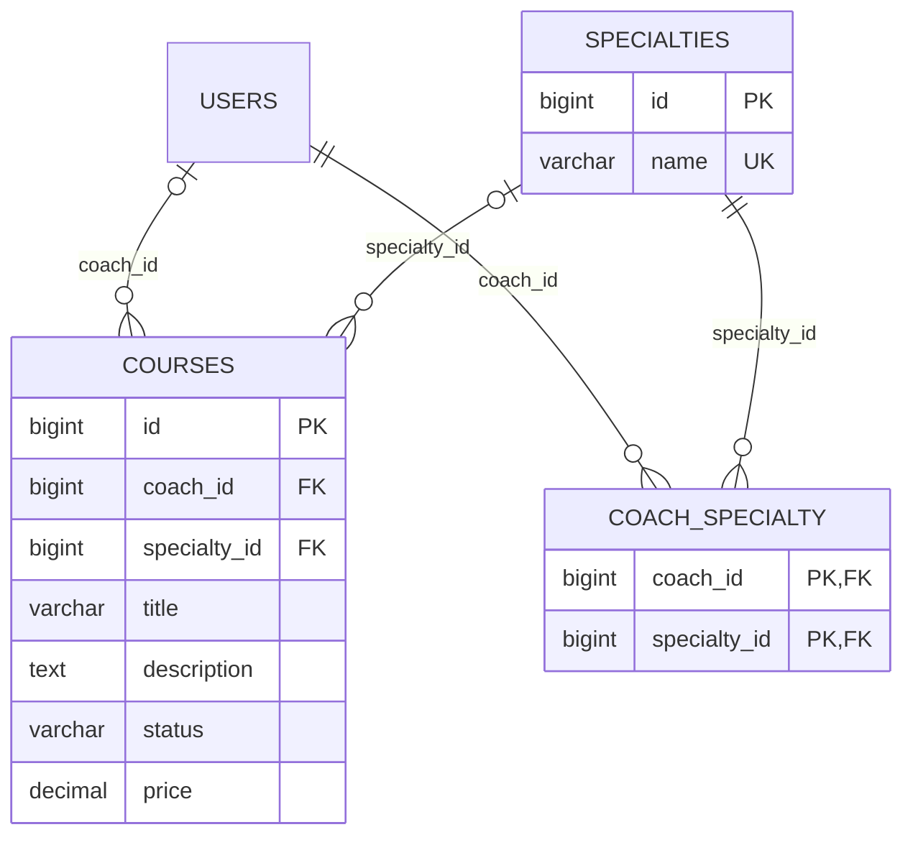

# Datos iniciales de cursos y especialidades

El modelo organiza los cursos por especialidad y relaciona cada Coach con las materias que puede impartir. El esquema se reproduce mediante migraciones. La creación de cursos mediante API sigue pendiente.

## Tablas y decisiones

`specialties`: `id`, `name` (texto de hasta 100 caracteres, único), `created_at` y `updated_at`. Una especialidad puede agrupar varios cursos; cada curso tiene como máximo una especialidad. Se renombra la tabla anterior `categories` conservando filas e identificadores. No hay una categoría general adicional.

`coach_specialty`: `coach_id` a `users.id` y `specialty_id` a `specialties.id`, con clave primaria compuesta para impedir asociaciones repetidas e índice por especialidad para buscar sus Coaches. Un Coach puede tener varias especialidades y cada especialidad varios Coaches. Al eliminar un usuario o especialidad sin cursos que lo impidan se eliminan sus asociaciones, sin borrar el otro extremo. No se añadieron datos de ejemplo ni se asignaron especialidades a las cuentas existentes.

`courses` conserva sus campos originales y añade:

| Campo | Tipo y valor inicial | Responsabilidad |
| --- | --- | --- |
| `coach_id` | FK nullable a `users.id` | Coach responsable; no es necesariamente quien pulsa crear |
| `specialty_id` | FK nullable a `specialties.id` | Asignatura o videojuego del curso; sustituye `category_id` |
| `status` | `draft` por defecto; admite `draft` o `published` | Separar preparación y publicación |
| `price` | `DECIMAL(10,2)`, obligatorio, 0 por defecto; CHECK >= 0 | Importe en euros; cero significa gratuito |

Las FK admiten nulos para conservar cursos anteriores sin inventar responsables ni especialidades. El futuro endpoint deberá exigir asignaciones válidas, comprobar que el responsable tenga rol Coach y que pertenezca a la especialidad elegida; las FK por sí solas solo acreditan existencia. Las reglas de asignación al crear o publicar un curso siguen pendientes. Un administrador podrá asignar un Coach cuando se concrete el endpoint; no se asigna automáticamente un Student como responsable. El curso sigue teniendo un único Coach responsable.

Las eliminaciones de usuarios/especialidades referenciados por cursos se restringen: borrar una cuenta o especialidad no elimina cursos ni rompe referencias. No se añaden borrado lógico, pagos ni inscripciones. EUR es la moneda funcional acordada para esta primera versión; no hay conversión ni cobros. No se duplica el precio con un booleano `is_free`.

Relaciones Eloquent utilizadas en pruebas: `User::specialties()` y `Specialty::coaches()` con belongsToMany; `Specialty::courses()` con hasMany; `Course::specialty()` y `Course::coach()` con belongsTo. `Specialty::coaches()` filtra por rol Coach, incluso si una asociación errónea de un Student se insertara directamente en la base. El filtro de lectura no sustituye la futura autorización de escritura. El precio del modelo Course se convierte a decimal de dos posiciones.



## Migraciones y comprobaciones

Se conserva íntegra la migración original de courses. Nuevas migraciones:

- [Crear categories](../backend/database/migrations/2026_11_15_000001_create_categories_table.php).
- [Ampliar courses](../backend/database/migrations/2026_11_15_000002_add_details_to_courses_table.php).
- [Renombrar categoría como especialidad](../backend/database/migrations/2026_11_15_000003_rename_categories_to_specialties.php).
- [Relacionar Coaches con especialidades](../backend/database/migrations/2026_11_15_000004_create_coach_specialty_table.php).

Las dos primeras migraciones ya aplicadas se conservan sin modificaciones. El renombrado usa operaciones nativas para conservar las FK y el CHECK de precio; PostgreSQL requiere además renombrar explícitamente la restricción de `courses.category_id`. El índice único del nombre conserva su nombre histórico, sin alterar su comportamiento. Las reversiones se prueban únicamente en bases aisladas; revertir la tabla intermedia elimina sus asociaciones y no es un procedimiento para reiniciar desarrollo.

El CHECK de precio está definido en la columna mediante SQL común a PostgreSQL y SQLite. La columna monetaria usa precisión decimal real en PostgreSQL; SQLite tiene afinidad numérica y no reproduce toda su precisión. No se afirma equivalencia total entre motores.

Desde la raíz, con desarrollo arrancado:

```powershell
docker compose --env-file .env -p dawtfg -f compose.yaml -f compose.heidi.yaml exec -T backend composer test
./scripts/Test-Backend.ps1
docker compose --env-file .env -p dawtfg -f compose.yaml -f compose.heidi.yaml exec -T backend composer run format:check
```

Las pruebas de esquema se ejecutan en bases aisladas; no revertir migraciones sobre datos de desarrollo para comprobarlas. El esquema no equivale a un flujo completo de creación de cursos.
